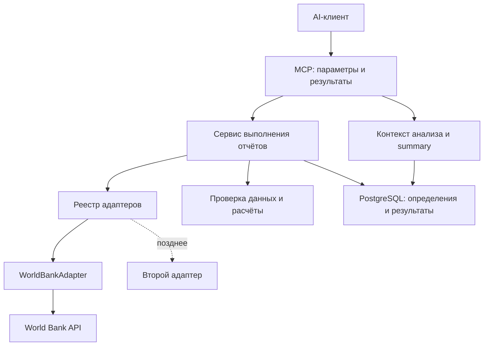

# Design doc: универсальный MCP-сервер отчётов

Версия: 0.4 · Дата: 8 октября 2026 года · Статус: проектное предложение для учебной реализации

## 1. Идея и цель

Создать пет-проект на Node.js, TypeScript и NestJS, который получает данные из внешнего API, строит воспроизводимые отчёты и предоставляет их AI-клиенту через MCP.

Первый источник — World Bank, первый предмет анализа — показатели стран за годы. Пользователь выбирает страны, показатели и период обычным текстом в AI-клиенте. Сервер проверяет запрос, получает данные, выполняет расчёты и сохраняет результат. Клиент объясняет цифры и при необходимости использует свои инструменты поиска внешнего контекста.

Проект должен быть интересен лично автору и давать практику backend-разработки уровня middle: разделение ответственности, внедрение зависимостей, внешние API, динамическая валидация, расчёты, PostgreSQL, версии, ошибки и интеграционные проверки.

**Инженерная цель:** показать разделение ответственности, надёжность интеграций, целостность данных и проверяемость решений на собеседовании. Продуктовый сценарий помогает проверить реализацию; коммерческую необходимость отдельного сервиса не доказываем.

**Универсальность:** ядро работает с наборами данных, описанием полей и разрешёнными операциями. World Bank — адаптер с собственной логикой запросов и метаданными. Добавление следующего источника потребует нового адаптера; поддержку произвольного API без кода не обещаем.

## 2. Первый пользовательский сценарий

> «Сравни население Германии, Финляндии и России за 2015–2024 годы. Покажи изменение за период и сохрани отчёт».

1. AI узнаёт доступные наборы данных, страны и показатели.
2. Если просьба неоднозначна, клиент уточняет показатель или период.
3. Клиент вызывает run_report с явными параметрами.
4. Сервер проверяет страны, показатели, годы и разрешённые операции.
5. Адаптер получает все необходимые страницы ответа World Bank.
6. Сервер нормализует записи, проверяет данные и рассчитывает результат.
7. Результат и использованные наблюдения сохраняются.
8. Клиент показывает таблицу и ограничения.

Следующая просьба:

> «Учти предыдущие отчёты и объясни, что изменилось».

Клиент вызывает get_analysis_context. Сервер возвращает текущий результат, до трёх сопоставимых предыдущих запусков и версию инструкций для анализа. Клиент формирует summary и по явной просьбе пользователя сохраняет его через save_summary.

**Сервер не управляет поведением произвольного AI-клиента.** Описания инструментов и шаблон помогают, но не гарантируют автоматическое выполнение всех шагов. Сквозной сценарий проверяется в конкретном выбранном клиенте.

## 3. Границы версии 1

| Входит                                                      | Откладываем                                      |
| ----------------------------------------------------------- | ------------------------------------------------ |
| Один адаптер World Bank, набор World Development Indicators | Второй реальный источник                         |
| Годовые наблюдения                                          | Месячные и квартальные данные                    |
| Каталог стран и ограниченный каталог показателей            | Полный поиск по всем наборам World Bank          |
| Таблица значений, изменение между годами, рейтинг           | Корреляции, прогнозы, причинный анализ           |
| Сохранённые определения отчётов и их версии                 | Визуальный конструктор                           |
| Неизменяемые результаты и история                           | Плановые запуски и фоновые очереди               |
| Контекст для AI и сохранение summary                        | LLM внутри backend                               |
| Один пользователь; защита удалённого доступа перед деплоем  | Мультипользовательские роли                      |
| MCP через Streamable HTTP локально и после деплоя           | Дополнительный stdio-bootstrap при необходимости |

Универсальные sum, avg и count добавляем постепенно, с проверкой семантики показателей. Начинаем с таблицы и сравнений: сумма годовых значений населения или обычное среднее процентов стран могут вводить в заблуждение.

Отдельный Demo CRM, универсальный веб-парсер и собственный поисковик не нужны.

## 4. Архитектура

Первая реализация: один модульный NestJS-процесс и PostgreSQL. Сразу выделяем границы запуска, исполнения и кеширования. Очередь, отдельные worker и Redis подключаем отдельным инженерным этапом; общий расчёт и сохранённые определения при этом сохраняются.



MCP — транспортная граница. Бизнес-операции находятся в сервисах NestJS; MCP-обработчики вызывают их. Это позволяет позднее добавить HTTP API без копирования логики расчётов.

Nest создаёт и связывает providers через dependency injection. Модули задают доступность сервисов через imports и exports [N1, N2]. Реестр SourceRegistry получает массив адаптеров через токен DATA_SOURCE_ADAPTERS и выбирает нужный по sourceId. В первой версии в массиве только WorldBankAdapter. TypeScript-интерфейс сам по себе не является runtime-токеном. Не используем ветвление по sourceId внутри сервиса расчётов.

### Модули

| Модуль            | Ответственность                                                  |
| ----------------- | ---------------------------------------------------------------- |
| ConfigModule      | Настройки, лимиты и проверка конфигурации при запуске            |
| SourcesModule     | Реестр адаптеров, World Bank HTTP-клиент, каталог и нормализация |
| DatasetsModule    | Описания полей, версии схем и разрешённых операций               |
| ReportsModule     | Определения, версии, приём задания, сравнение, история           |
| ExecutionModule   | ReportExecutor, диспетчер заданий и управление попытками         |
| AnalysisModule    | Сбор контекста, инструкции, сохранение summary                   |
| PersistenceModule | Prisma и репозитории                                             |
| McpModule         | Регистрация инструментов и перевод ошибок в MCP-результаты       |

Расчёты оформляем чистыми функциями: данные на входе → результат на выходе, без HTTP и базы внутри. Это упрощает ручной разбор и проверку.

### Границы для очереди и Redis

| Компонент        | Ответственность                                        | Первая реализация              | Следующий этап                      |
| ---------------- | ------------------------------------------------------ | ------------------------------ | ----------------------------------- |
| ReportService    | Валидация, создание ReportRun, идемпотентность запроса | PostgreSQL                     | Без изменения ответственности       |
| ReportDispatcher | Передача runId исполнителю                             | InlineDispatcher: прямой вызов | QueueDispatcher: постановка задания |
| ReportExecutor   | Захват запуска, загрузка, расчёт, фиксация результата  | В HTTP-процессе                | Тот же код в worker                 |
| SourceCache      | Кеширование разрешённых ответов источника              | NoopCache: всегда промах       | RedisCache                          |

Контракт диспетчера — submit(runId); бизнес-параметры уже сохранены в БД. В сообщение не помещаем полный отчёт или секреты. Не создаём универсальную обёртку всех возможностей разных брокеров.

InlineDispatcher ждёт исполнителя. QueueDispatcher подтверждает принятие задания; клиент получает runId и проверяет состояние через get_report_run. В будущем несколько worker могут использовать одну PostgreSQL. HTTP-приложение и worker — два режима запуска одного репозитория с общей логикой, а не обязательное разбиение на микросервисы.

Кеш располагается на границе получения данных из источника. Его интерфейс содержит get, set с TTL и delete; значения проверяются по схеме. Первым кешируем каталоги. Кеш наблюдений включаем отдельно с политикой fresh/cached и временем получения. NoopCache не требует Redis.

Ключ кеша включает sourceId, datasetId, schemaVersion и нормализованные параметры запроса. Для защищённого источника ключ дополнительно учитывает область доступа пользователя. Ошибка кеша приводит к обращению в источник, а не потере сохранённого отчёта. PostgreSQL остаётся источником истины о запусках.

## 5. Технологические решения

- Node.js и TypeScript — runtime и язык.
- NestJS — жизненный цикл приложения, модули и DI.
- Официальный MCP TypeScript SDK — протокол, регистрация инструментов и transport.
- Zod — контракты параметров MCP и проверки нормализованных записей.
- PostgreSQL + Prisma — сохранённые определения, запуски и summary.
- Встроенный HTTP-клиент Node.js — запросы к World Bank.
- Docker Compose — локальная PostgreSQL.
- Встроенный test runner либо привычный проекту Jest — выбираем один при создании проекта.

Точные версии Node.js, NestJS, Prisma и MCP SDK фиксируем при старте в package.json и lockfile после проверки совместимости. Код не строим по смешанным примерам разных поколений SDK.

### Основной транспорт: Streamable HTTP

NestJS запускается как HTTP-приложение. SDK обслуживает MCP endpoint /mcp через интеграцию с HTTP-адаптером Nest; протокол вручную не реализуем. Обычные Nest controllers, pipes и guards не считаем автоматически применёнными к прямому SDK-handler: маршрутизацию, валидацию и авторизацию проверяем на фактическом пути запроса.

| Среда            | Подключение                             |
| ---------------- | --------------------------------------- |
| Локальный запуск | http://localhost:3000/mcp               |
| Удалённый запуск | https://<домен>/mcp через reverse proxy |

Клиент подключается по URL, приложение работает как самостоятельный процесс. Для первого сценария выбираем stateless MCP transport [M3]: связь конкретного запроса не хранит бизнес-состояние. Определения, результаты и история находятся в PostgreSQL. Stateless не означает отсутствие базы данных и не гарантирует автоматическую совместимость со всеми клиентами.

Настройки и обработку HTTP-методов endpoint берём из установленного SDK и поддерживаемой версии протокола. Не трактуем /mcp как обычный REST endpoint с собственным JSON-форматом. Проверяем initialize, обнаружение инструментов и вызов через настоящий MCP-клиент.

Стандартные логи HTTP-приложения могут идти в stdout/stderr; запрет логов в stdout относится к отдельному stdio-bootstrap, который в первую версию не входит.

### Авторизация

Локальный учебный запуск без авторизации разрешён только при привязке порта к loopback. Для удалённого доступа аутентификация обязательна до публикации.

На раннем этапе используем Bearer-токен из окружения и собственный test client либо клиент, поддерживающий настройку заголовков. Это ограниченный способ доступа, не полноценная реализация MCP OAuth. Возможность настройки заголовков у выбранного клиента проверяем отдельно.

Если целевой клиент требует стандартный MCP authorization flow, перед деплоем интегрируем OAuth-провайдера и protected resource metadata по поддерживаемой версии спецификации [M4]. Собственный сервер выдачи OAuth-токенов не пишем. Проверяем срок действия, issuer, audience и scopes; возвращаем HTTP 401/403 на границе HTTP, а не маскируем отсутствие доступа под ошибку расчёта.

Origin и Host валидируются по явным allowlist. Запрос без Origin от нативного клиента не отклоняется только из-за отсутствия заголовка. CORS не заменяет аутентификацию. Токены не попадают в URL и логи.

## 6. Получение данных World Bank

World Bank возвращает временные ряды и метаданные показателей. API поддерживает JSON, диапазон лет, page и per_page [W1, W2].

Пример запроса одного показателя:

```text
https://api.worldbank.org/v2/country/DEU;FIN;RUS/indicator/SP.POP.TOTL?source=2&date=2015:2024&format=json&per_page=1000&page=1
```

source=2 закрепляет выбранный набор World Development Indicators. Идентификатор источника включаем в ключи данных: один код показателя может встречаться в разных источниках [W1].

Для первых пяти показателей каталог создаём явно:

| Код               | Показатель                   | Интерпретация                                        |
| ----------------- | ---------------------------- | ---------------------------------------------------- |
| SP.POP.TOTL       | Население                    | Количество людей                                     |
| NY.GDP.PCAP.CD    | ВВП на душу населения        | Текущие доллары США; не поправка на инфляцию или ППС |
| NY.GDP.MKTP.KD.ZG | Рост ВВП                     | Годовой процент                                      |
| FP.CPI.TOTL.ZG    | Инфляция потребительских цен | Годовой процент                                      |
| SL.UEM.TOTL.ZS    | Безработица, оценка ILO      | Процент рабочей силы                                 |

При реализации запрашиваем метаданные каждого кода и подтверждаем определения. Название «ВВП на душу» не даёт права незаметно заменить текущие доллары на постоянные или ППС.

Метаданные API содержат описание и организацию-источник, но поле unit может быть пустым [W1]. Для стартового каталога храним проверенное описание единиц и семантический тип сами. Не определяем единицу эвристикой из названия.

Адаптер:

- закрепляет HTTPS-host api.worldbank.org; пользователь передаёт коды, а не произвольный URL;
- читает служебную часть ответа и все страницы;
- проверяет форму JSON и ошибки API независимо от HTTP-статуса;
- сортирует наблюдения по году и проверяет уникальность ключей;
- отделяет страны от агрегатов регионов; в первой версии региональные агрегаты исключены;
- сохраняет footnote, когда доступна, и время получения;
- не включает автоматическое заполнение пропусков.

## 7. Контракт источника и схема набора данных

### 7.1. Граница адаптера

Общий контракт описывает данные и получает записи. Пагинация внешнего API, его URL, авторизация и преобразование ответа остаются внутри конкретного адаптера.

| Операция DataSourceAdapter | Вход                                   | Выход                                         |
| -------------------------- | -------------------------------------- | --------------------------------------------- |
| listDatasets               | —                                      | Доступные datasetId и описания                |
| describeDataset            | datasetId                              | Версия схемы, поля, меры и возможности        |
| listDimensionValues        | datasetId, field, query, cursor, limit | Значения выбранного поля и nextCursor         |
| listMeasures               | datasetId, query, cursor, limit        | Числовые меры, единицы и допустимые операции  |
| fetchRecords               | Валидированный DataQuery, AbortSignal  | RecordBatch: записи, качество и происхождение |

Это проектный контракт, не готовая библиотечная сигнатура. Его TypeScript-типы создаём и проверяем на первом адаптере.

DataQuery содержит sourceId, datasetId, schemaVersion, filters, period и запрашиваемые поля. Первая версия filters поддерживает eq и in по разрешённым полям; period — диапазон целочисленных лет по объявленному temporalField. Дневные даты и произвольный язык запросов откладываем.

RecordBatch содержит records, schemaVersion, provenance, transportComplete и сведения о покрытии. Каждая запись — плоский объект string | number | boolean | null. Значения проверяются по схеме набора, а не только общему TypeScript-типу. Признаки качества и ограничения не прячем внутри свободного текста.

Адаптер возвращает весь ограниченный пакет либо ошибку. Он может выполнить фильтр через API или после загрузки в памяти, но обязан сохранить смысл запроса и общие лимиты. Необязательные возможности объявляются в capabilities; неподдерживаемый запрос отклоняется до расчётов.

### 7.2. Схема описывает роли полей

Общие роли: dimension — поле группировки, temporal — время, measure — числовое значение. Имена countryCode и indicatorCode не входят в обязательный контракт ядра. Ядро получает их из определения конкретного набора.

Описание меры содержит valueField, при необходимости selector, unit, semanticType и allowedOperations. Для World Bank selector выбирает indicatorCode: одинаковое поле value имеет разную семантику для населения и инфляции. Для второго источника мерой может быть просто temperature без selector.

Разрешённые операции задаются по проверенным метаданным адаптера. Недостаточные метаданные означают ограничение операций, а не предположение о допустимости суммы или среднего.

### 7.3. Пример World Bank

Для World Bank нормализуем ответы в плоские записи:

```json
{
  "sourceId": "world-bank",
  "sourceDatasetId": "2",
  "countryCode": "DEU",
  "indicatorCode": "SP.POP.TOTL",
  "year": 2020,
  "value": null
}
```

Пример демонстрирует структуру, а не реальное значение показателя.

Описание полей хранится отдельно:

| Поле          | Тип             | Ограничения                                        |
| ------------- | --------------- | -------------------------------------------------- |
| countryCode   | string          | Страна из каталога; разрешено группировать         |
| indicatorCode | string          | Показатель из каталога; разрешено группировать     |
| year          | integer         | Год; разрешены фильтрация и сортировка             |
| value         | number или null | Числовые операции зависят от метаданных показателя |

Схема имеет version. Изменение типа или смысла поля создаёт новую версию. Первая версия описывается в конфигурации адаптера; пользовательское редактирование схем не входит в MVP. Так сохраняем практику динамической валидации, не превращая проект в универсальную базу данных.

sourceId и sourceDatasetId являются также частью происхождения пакета. Их наличие в строке World Bank удобно, но не обязательно для каждого набора. Уникальность наблюдений определяется ключевыми полями схемы: здесь countryCode + indicatorCode + year.

### 7.4. Проверка на втором источнике

После завершённого World Bank-сценария подключаем сначала FixtureAdapter с другим набором: station, year, temperature. Это детерминированные учебные данные, не второй внешний API. Схема объявляет station как dimension, year как temporal и temperature как measure; разрешает изменение и рейтинг, но запрещает сумму температур.

Второй реальный сервис выбираем после этой проверки. Его подключение требует реализации адаптера, описания схемы и регистрации в SourceRegistry. Общие расчёты, сохранение результатов, история и инструменты MCP не должны требовать ветвлений для нового sourceId. Если обнаружится действительно новая аналитическая возможность, расширяем общий контракт явно и проверяем оба адаптера.

Критерий готовности границы: один и тот же run_report строит отчёт по населению и по температуре из FixtureAdapter; запрет sum применяется на основании метаданных меры. FixtureAdapter подтверждает отделение ядра от названий полей, но сам по себе не доказывает поддержку любой внешней интеграции.

## 8. Определение отчёта

Сначала поддерживаем три вида:

1. time_series — таблица выбранных мер по измерениям и годам.
2. period_change — изменение между двумя явно указанными годами внутри каждой группы.
3. ranking — сортировка групп по одной мере за один общий год.

Страны и показатели — выбор полей набора World Bank, а не специальные аргументы ядра.

Пример сохранённого определения:

```json
{
  "name": "Население выбранных стран",
  "sourceId": "world-bank",
  "datasetId": "wdi",
  "schemaVersion": 1,
  "kind": "period_change",
  "filters": [
    { "field": "countryCode", "operator": "in", "value": ["DEU", "FIN", "RUS"] }
  ],
  "groupBy": ["countryCode"],
  "measures": [{ "id": "SP.POP.TOTL" }],
  "period": { "field": "year", "fromYear": 2015, "toYear": 2024 },
  "missingPolicy": "strict_endpoints",
  "sort": { "field": "countryCode", "direction": "asc" }
}
```

При сохранении проверяем структуру определения и семантическую совместимость. При запуске проверяем снова: каталог и схема могли измениться.

Запуск сохранённого отчёта может переопределять только период. Изменение фильтров, группировок, мер или метода расчёта требует новой версии определения.

Конструктор первой версии — ограниченный набор допустимых полей и операций, без пользовательского SQL, JavaScript или формул для eval.

## 9. Правила расчёта и качества данных

- null означает отсутствие значения; не заменяем нулём.
- Временной ряд содержит явные пропуски. Coverage показывает expectedPoints и availablePoints. Ожидаемую сетку описывает набор данных: в World Bank это выбранные страны × показатели × годы; ядро не угадывает её по фактически полученным строкам.
- Все страницы успешно получены — transportComplete=true. Это не означает, что наблюдение существует для каждого года.
- При сбое страницы запуск failed. Частичный результат не публикуем как completed.
- При полном ответе с пропусками запуск completed с предупреждениями; отдельный расчёт может быть unavailable.
- Для изменения нужны значения ровно в fromYear и toYear. Не подменяем отсутствующий год «ближайшим доступным».
- Абсолютное изменение: end − start.
- Относительное изменение: (end − start) / start × 100; в первой версии только для разрешённых показателей и положительного start.
- При нулевом или отрицательном start относительное изменение unavailable с причиной. Абсолютное изменение может оставаться доступным.
- Для процентных показателей по умолчанию показываем разницу в процентных пунктах: 5% → 7% означает +2 п.п.
- Нельзя смешивать показатели с разными кодами или единицами в одну сумму.
- По умолчанию не суммируем проценты, ВВП на душу и значения населения разных лет.
- Count наблюдений отличается от суммы значения показателя; явно именуем результат.
- Рейтинг использует один общий год. Страны без значения перечисляются отдельно.
- Округление применяется только к отображению; внутренние вычисления используют исходные числа. Не используем эти результаты как финансовый бухгалтерский расчёт.

Стартовые лимиты проекта: до 10 групп, 5 мер, 30 лет и 1500 нормализованных наблюдений в одном запуске. Для World Bank группы соответствуют странам; адаптер проверяет объём до полной загрузки и по мере получения страниц. Это наши ограничения, не заявленные лимиты World Bank.

## 10. Сохранение и версии

| Сущность                | Основные поля                                                                                                                        |
| ----------------------- | ------------------------------------------------------------------------------------------------------------------------------------ |
| DatasetSchema           | datasetId, version, fields, metadata                                                                                                 |
| ReportDefinition        | id, name, createdAt                                                                                                                  |
| ReportDefinitionVersion | definitionId, version, schemaVersion, config                                                                                         |
| ReportRun               | id, definitionVersionId?, effectiveConfig, status, timestamps, error; при очереди attempt, leaseOwner, leaseUntil, cancelRequestedAt |
| OutboxEvent             | На этапе очереди: id, runId, eventType, deliveredAt, attempts                                                                        |
| ReportSnapshot          | runId, observations, metrics, coverage, sourceMetadata, engineVersion                                                                |
| AnalysisSummary         | id, runId, referencedRunIds, promptVersion, text, createdAt                                                                          |

Разовое выполнение допускается без сохранённого определения; effectiveConfig всё равно сохраняется.

На первом этапе небольшие observations и результаты можно хранить JSONB, а отношения и статусы — обычными колонками. Сырые HTML или полный каталог всех показателей не сохраняем.

ReportRun создаётся как queued. Переход queued → running выполняется атомарно в БД: только один исполнитель получает право обработки. Повторная доставка для completed не пересчитывает результат; второй исполнитель не начинает работу, пока первый владеет запуском. Snapshot и статус completed фиксируются одной транзакцией.

Состояния: queued, running, completed, failed, cancelled. Повтор после временного сбоя допускает running → queued в пределах лимита попыток; окончательная ошибка даёт failed. Ручной перезапуск завершённого запуска создаёт новый runId.

В первой версии один процесс; после аварии его незавершённые running помечаются failed с причиной PROCESS_INTERRUPTED. Режим нескольких процессов нельзя включать с таким восстановлением.

На этапе worker добавляем leaseOwner, leaseUntil и attempt: ограниченное по времени право исполнения с продлением. После истечения lease задание может быть захвачено заново. Фиксация результата проверяет текущий attempt и владельца, чтобы старый исполнитель не перезаписал результат после передачи задания другому. Сетевые запросы могут повториться; право сохранения результата защищено БД.

### Согласование БД и очереди

Сразу оставляем точку расширения для transactional outbox; сам механизм реализуем вместе с очередью. На этом этапе ReportRun и OutboxEvent создаются одной транзакцией. Отдельный publisher отправляет событие в очередь, затем отмечает доставку. Если он упадёт между отправкой и отметкой, событие может уйти повторно: executor обязан безопасно обработать повтор.

Идемпотентность clientRequestId защищает приём запроса, а захват запуска и проверка attempt защищают обработку задания. Это разные механизмы. Ошибка Redis или брокера не должна оставлять принятый запуск без возможности повторной доставки. Очередь не является единственным хранилищем намерения выполнить отчёт.

Завершённый snapshot не изменяется. Повторное получение данных создаёт новый запуск. Сохраняем сами использованные наблюдения: сохранённые итоговые числа без исходных значений недостаточны для воспроизводимости.

engineVersion фиксирует версию правил расчёта, schemaVersion — структуру набора, definitionVersion — намерение пользователя. Результаты разных версий не считаем автоматически сопоставимыми.

## 11. MCP-контракт

Все инструменты имеют описание, схему входа и структурированный результат. Не возвращаем огромные данные одним ответом.

| Инструмент               | Назначение                                                     | Этап         |
| ------------------------ | -------------------------------------------------------------- | ------------ |
| list_datasets            | Наборы данных и возможности                                    | 1            |
| describe_dataset         | Поля, типы, ограничения и schemaVersion                        | 1            |
| list_dimension_values    | Значения поля набора: например страны или станции              | 1            |
| list_measures            | Числовые меры, единицы и допустимые операции                   | 1            |
| run_report               | Разовое или сохранённое выполнение                             | 2            |
| get_report_run           | Статус и результат по runId, страницы строк                    | 2            |
| cancel_report_run        | Запрос отмены queued/running; терминальные состояния неизменны | Этап очереди |
| save_report_definition   | Сохранение определения                                         | 3            |
| update_report_definition | Новая версия с expectedVersion                                 | 3            |
| list_report_definitions  | Сохранённые определения                                        | 3            |
| list_report_runs         | История запусков                                               | 3            |
| get_analysis_context     | Результат, сопоставимая история, инструкции                    | 4            |
| save_summary             | Сохранение анализа с ссылками на runId                         | 4            |

run_report принимает либо definitionId и период, либо полное definition — не оба одновременно. Возвращает runId, статус, ограниченную таблицу, coverage и warnings. В первой версии InlineDispatcher выполняет отчёт синхронно с общим дедлайном. После подключения очереди run_report возвращает runId со статусом queued; get_report_run показывает текущий статус и результат после completed. Общая форма ответа предусмотрена сразу: данные результата доступны только после завершения.

list_datasets возвращает sourceId и datasetId. describe_dataset, list_dimension_values и list_measures используют эти ID; названия полей берутся из схемы. Пользователь может просить «страны», но отдельный World Bank-инструмент list_countries не требуется.

get_report_run и каталоги имеют limit/cursor. Cursor относится к выдаче нашего сервера, а не копируется из World Bank.

У изменения определения есть expectedVersion: параллельное редактирование возвращает VERSION_CONFLICT, а не теряет изменения.

Для операций создания определения и summary поддерживаем clientRequestId. Его уникальность и хеш запроса предотвращают дубли при повторе. run_report с тем же requestId возвращает существующий запуск; новый ID означает новое выполнение. Не обещаем магическую гарантию exactly once для внешнего источника.

MCP Prompt analyze_report можно добавить как удобный именованный шаблон для клиентов, которые его поддерживают. Prompts вызываются клиентом; их наличие не заставляет модель автоматически их применять [M2]. Поэтому основной путь — явный get_analysis_context.

## 12. AI-анализ и предыдущие отчёты

get_analysis_context возвращает:

- текущий runId и проверенные backend показатели;
- до трёх сопоставимых запусков;
- сравнения, рассчитанные backend;
- ограничения и пропуски;
- instructions и promptVersion;
- признаки обрезки контекста.

Сопоставимость проверяется по sourceId, datasetId, фильтрам, группировкам, мерам, виду отчёта, единицам, schemaVersion, engineVersion и правилам пропусков. Списки и фильтры перед вычислением ключа нормализуются: перестановка стран в in не меняет смысл запроса. Период исключён из ключа сопоставимости.

Различаем два режима:

1. previous_periods — предыдущие непересекающиеся интервалы такой же длины; пропуски в истории явно показываются.
2. same_period_revisions — предыдущие запуски за тот же период, чтобы увидеть пересмотр исходных данных.

Повторные запуски одного периода не должны изображать несколько последовательных периодов. Новая история сама не рассчитывается: для отсутствующего периода нужен отдельный run_report.

В MVP historyLimit ≤ 3, таблицы имеют лимит строк, длинные summary обрезаются с флагом truncated. В первую очередь отдаём показатели и предупреждения; прошлые тексты вторичны.

### Общие инструкции для анализа

> Используй текущий результат и явно переданную историю. Указывай runId и период для числовых выводов. Не заполняй пропуски выдуманными значениями. Отделяй рассчитанные факты от предположений. Не делай причинных выводов по одному совпадению показателей. Если использовал интернет, укажи источник и дату. Не считай прежнее summary доказательством. Заверши ограничениями анализа и вопросами для проверки.

Первоначально шаблон хранится в коде с версией. Summary сохраняется отдельно от snapshot, вместе с текущим и использованными предыдущими runId. Указанные ID и promptVersion проверяются сервером; достоверность каждого предложения AI сервер автоматически не гарантирует.

Отдельный LLM API не подключаем. Поиск и чтение сайтов выполняет клиент, если такие инструменты у него доступны.

## 13. Ошибки и ограничения запросов

| Код                                       | Поведение                                           |
| ----------------------------------------- | --------------------------------------------------- |
| INVALID_REPORT_DEFINITION                 | Параметры не соответствуют контракту                |
| UNKNOWN_DIMENSION_VALUE / UNKNOWN_MEASURE | Неизвестное значение поля или неподдерживаемая мера |
| SOURCE_NOT_FOUND / DATASET_NOT_FOUND      | Источник или набор не зарегистрирован               |
| UNSUPPORTED_OPERATION                     | Несовместимая операция                              |
| SCHEMA_VERSION_MISMATCH                   | Нужна новая версия определения                      |
| SOURCE_TIMEOUT / SOURCE_UNAVAILABLE       | Получение данных не завершено                       |
| SOURCE_RESPONSE_INVALID                   | Нельзя доверять форме ответа                        |
| REPORT_LIMIT_EXCEEDED                     | Слишком большой запрос                              |
| VERSION_CONFLICT                          | Параллельное изменение определения                  |
| IDEMPOTENCY_CONFLICT                      | Один requestId использован для другого запроса      |
| RUN_NOT_FOUND                             | Запуск не найден                                    |

Отсутствующее наблюдение — предупреждение данных, а не обязательно ошибка всего запроса.

Стартовые настройки: таймаут HTTP-попытки 10 секунд, общий бюджет запуска 60 секунд, до двух повторов безопасных GET при временных сетевых сбоях, 429 и 5xx. Повторы с задержкой и случайным разбросом остаются внутри общего бюджета; учитываем Retry-After. Ошибки контракта и некорректный JSON не повторяем бесконечно.

Отмена MCP-запроса передаётся HTTP-клиенту через AbortSignal там, где выбранный SDK даёт соответствующую возможность.

## 14. Наблюдаемость и локальная эксплуатация

Логи содержат requestId, runId, инструмент, длительность, число полученных страниц, объём данных и код ошибки. Не пишем весь контекст и summary в логи.

Локально:

- приложение запускается самостоятельно; MCP-клиент подключается по HTTP к /mcp;
- PostgreSQL запускается Docker Compose;
- адрес БД задаётся переменной окружения;
- приложение корректно закрывает подключения при завершении;
- небольшие результаты можно получить без браузера через MCP test client.

В первом сценарии работает NoopCache. RedisCache подключаем отдельным этапом для каталогов, задавая TTL. Время получения и использование кеша отражаем в происхождении данных; кеш наблюдений требует явной политики fresh/cached.

### Деплой и завершение процесса

Первый целевой деплой — один экземпляр контейнера приложения, PostgreSQL и reverse proxy с TLS. Конкретный хостинг выбираем при реализации. Приложение внутри контейнера слушает 0.0.0.0, локальная публикация Docker-порта привязана к 127.0.0.1; после деплоя наружу доступен reverse proxy.

Конфигурация: PORT, DATABASE_URL, PUBLIC_BASE_URL, допустимые Host/Origin, лимиты и параметры авторизации. Секреты передаются окружением, не коммитятся в репозиторий.

GET /health/live показывает работоспособность процесса; GET /health/ready — готовность приложения и доступность БД. Проверка World Bank не входит в readiness: временный сбой источника не должен вызывать бесконечные перезапуски.

Таймаут reverse proxy задаём больше общего бюджета синхронного отчёта с запасом на сохранение и ответ. Если SDK использует SSE-ответы, отключаем мешающую буферизацию и проверяем передачу событий. На этапе очереди HTTP-запрос ждёт только принятия задания; отчёт выполняется в worker с собственным дедлайном. HTTP-таймаут и дедлайн задания — разные настройки.

При SIGTERM прекращаем приём новых запросов, ждём активные операции в пределах заданного grace period, затем закрываем HTTP и Prisma. Сначала реализуем явное завершение; аварийное прерывание оставляет running для восстановления при следующем старте.

Отмена и сохранение имеют понятную границу: до фиксации snapshot подтверждённая отмена завершает запуск cancelled; после успешной транзакции результат остаётся completed, даже если клиент не получил ответ. Повтор clientRequestId возвращает существующий запуск. В inline-режиме отключение клиента связываем с отменой только после проверки выбранного SDK. В режиме очереди отключение клиента не отменяет принятую задачу: используется отдельный cancel_report_run и сохранённый cancelRequestedAt. Executor проверяет отмену между этапами; финальная транзакция условно фиксирует completed только при отсутствии запроса отмены.

## 15. Проверки и критерии готовности

Значимые автоматические проверки:

- расчёт абсолютного и относительного изменения;
- проценты против процентных пунктов;
- null, нулевой и отрицательный baseline;
- пропущенный крайний год;
- несколько страниц, неправильный JSON, timeout и сбой второй страницы;
- совпадение ключей наблюдений и некорректные типы;
- совместимость истории, дубли одного периода и пересмотр;
- транзакционное сохранение результата;
- expectedVersion и повтор clientRequestId;
- повторное исполнение runId не создаёт второй snapshot;
- инструменты через MCP test client по Streamable HTTP;
- HTTP 401/403, неверные Host/Origin и отсутствие секрета в логах;
- запуск контейнера, readiness и graceful shutdown;
- один набор контрактных проверок для WorldBankAdapter и FixtureAdapter;
- отчёт по иному имени числового поля без изменения ядра;
- запрет операции по метаданным и ошибка неизвестного sourceId.

Проверки воспроизводимы на сохранённых небольших fixtures. Живой World Bank — ручная проверка интеграции, не обязательная зависимость каждого тестового запуска.

Версия 1 готова, когда из выбранного AI-клиента можно:

1. найти страну и показатель;
2. выполнить отчёт для трёх стран;
3. увидеть пропуски и корректные изменения;
4. сохранить определение и повторить его;
5. получить сопоставимую историю;
6. сформировать и сохранить summary с ссылками на результаты;
7. убедиться, что сбой источника не создаёт успешный неполный отчёт.

### Проверки этапа очереди и Redis

- Два worker одновременно получают один runId: завершённый snapshot один.
- Падение worker до фиксации результата: lease истекает, задание может выполнить другой.
- Старый worker возобновляется после истечения lease: сохранение с устаревшим attempt отклоняется.
- Publisher падает после отправки outbox-события: повторная доставка не создаёт повторный результат.
- Брокер временно недоступен: outbox сохраняет намерение доставки.
- Redis-кеш недоступен: получение данных продолжает работать через источник.
- Истёкший кеш, разные фильтры и схема не возвращают неподходящий ответ.
- Отмена гоняется с фиксацией: запуск получает одно согласованное терминальное состояние.

## 16. Учебный план реализации

| Этап                   | Конкретный результат                                          | Что изучаем                                                   |
| ---------------------- | ------------------------------------------------------------- | ------------------------------------------------------------- |
| 0. Минимальный Nest    | Модуль, сервис и один вызов без MCP                           | Bootstrap, providers, DI, async/await                         |
| 1. World Bank          | Получение и проверка одного ряда, затем всех страниц          | HTTP, AbortSignal, адаптер, Zod, ошибки                       |
| 2. Отчёт + MCP HTTP    | Таблица и period_change через /mcp; временно память           | Чистые функции, MCP schemas, Streamable HTTP, ручная проверка |
| 3. PostgreSQL          | Определения, версии и сохранённые snapshots                   | Prisma, миграции, транзакции, optimistic locking              |
| 4. История + AI        | get_analysis_context и save_summary                           | Сопоставимость, лимиты контекста, идемпотентность             |
| 5. Надёжность и деплой | Проверки сбоев, авторизация, логи, Docker и HTTPS             | Интеграционные тесты, конфигурация и жизненный цикл           |
| 6. Проверка адаптеров  | FixtureAdapter с другой схемой, затем второй внешний источник | Контрактные проверки, DI, границы абстракции                  |
| 7. Очередь и Redis     | QueueDispatcher, worker, outbox, lease и RedisCache           | Повторная доставка, конкуренция, восстановление и кеширование |

На каждом этапе: разобрать механизм → сформулировать контракт → написать небольшой фрагмент самостоятельно → проверить вручную и тестами → объяснить решение своими словами. Полный сгенерированный backend не является учебным результатом.

## 17. Решения и вопросы, которые проверим при реализации

Уже выбрано: World Bank, NestJS, MCP, PostgreSQL, AI-анализ в клиенте, годовые данные, Streamable HTTP как основной транспорт, локальная разработка и один экземпляр сервиса при первом деплое.

Проверим без расширения MVP:

- Streamable HTTP-подключение и способ авторизации в выбранном клиенте;
- конкретные совместимые версии SDK и runtime;
- доступность стартовых показателей для выбранных стран и лет;
- разумные лимиты ответа после первого реального отчёта.

Граница адаптера проектируется сейчас; FixtureAdapter реализуется после первого законченного сценария. Второй внешний источник выбираем отдельно. Полный каталог показателей, экспорт CSV, графики, кеш наблюдений и плановые отчёты остаются расширениями.

### Технические альтернативы

| Решение                                 | Выбор и причина                                               |
| --------------------------------------- | ------------------------------------------------------------- |
| Один общий value для всех источников    | Не требуем: схема объявляет числовое поле и метаданные меры   |
| Страны и показатели в run_report        | Заменяем общими фильтрами, группировками и мерами             |
| Ветвление по источнику в ReportsService | Реестр адаптеров и общий контракт                             |
| Очередь с первого учебного шага         | Сначала InlineDispatcher; затем очередь с тем же исполнителем |
| Redis как хранилище запусков            | PostgreSQL хранит запуски; Redis может хранить кеш и задания  |
| Полноценная система сторонних плагинов  | Пока статическая регистрация providers через DI               |
| Адаптер сам рассчитывает отчёт          | Адаптер получает данные, общие функции считают результат      |
| Любое API через настройки               | Новому источнику нужен код адаптера; это осознанная граница   |

## 18. Официальные источники

Проверены 8 октября 2026 года. Ссылки описывают внешние API и механизмы фреймворков; лимиты, сущности и этапы выше — решения нашего проекта.

- [W1 — World Bank: метаданные показателей и источники](https://datahelpdesk.worldbank.org/knowledgebase/articles/898599-indicator-api-queries)
- [W2 — World Bank: диапазоны дат, JSON, пагинация и footnotes](https://datahelpdesk.worldbank.org/knowledgebase/articles/898581-api-basic-call-structures)
- [Каталог World Bank Indicators API](https://datahelpdesk.worldbank.org/knowledgebase/articles/889392-about-the-indicators-api-documentation)
- [Показатели World Bank](https://data.worldbank.org/indicator)
- [N1 — NestJS: providers и dependency injection](https://docs.nestjs.com/providers)
- [N2 — NestJS: modules](https://docs.nestjs.com/modules)
- [NestJS: standalone application context](https://docs.nestjs.com/standalone-applications)
- [Официальный MCP TypeScript SDK](https://ts.sdk.modelcontextprotocol.io/)
- [M1 — MCP: транспорты, документация версии 2025-11-25](https://github.com/modelcontextprotocol/modelcontextprotocol/blob/main/docs/specification/2025-11-25/basic/transports.mdx)
- [M2 — MCP TypeScript SDK: prompts](https://ts.sdk.modelcontextprotocol.io/v2/servers/prompts)
- [M3 — MCP TypeScript SDK: HTTP serving](https://github.com/modelcontextprotocol/typescript-sdk/blob/main/docs/serving/http.md)
- [M4 — MCP: HTTP authorization](https://github.com/modelcontextprotocol/modelcontextprotocol/blob/main/docs/specification/2026-07-28/basic/authorization/index.mdx)

Примеры из разных версий SDK не смешиваем. При реализации транспорт сверяем с версией протокола, поддерживаемой установленным SDK и выбранным клиентом.
